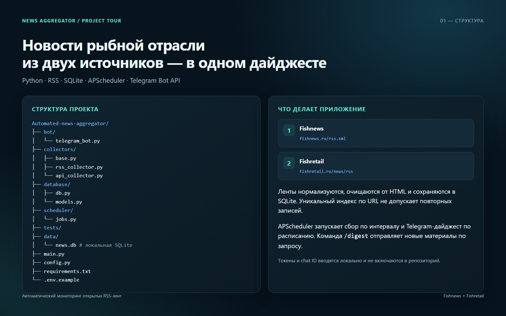
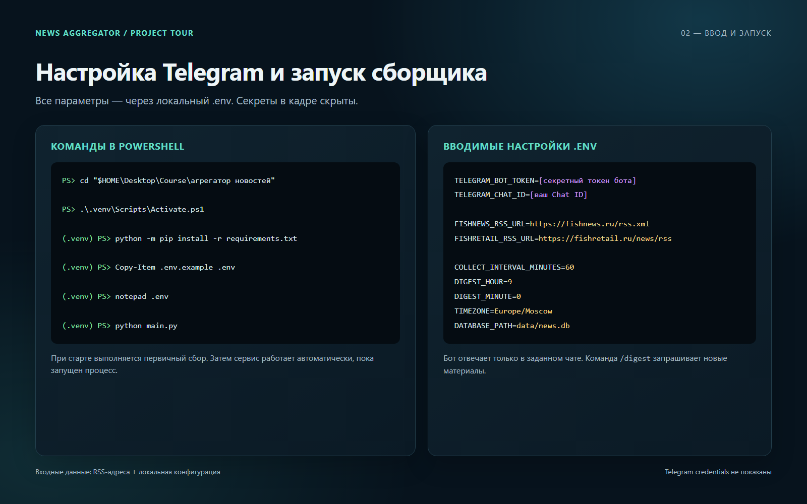
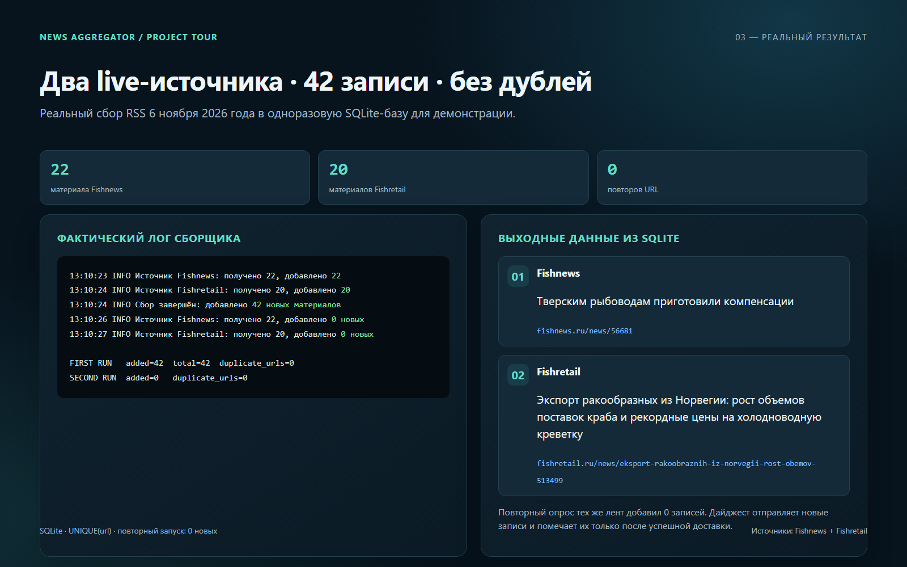

# Скринкаст проекта

Три кадра демонстрируют структуру проекта, ввод конфигурации и фактический
результат сбора:

1. [Структура проекта](01-project-structure.png)
2. [Ввод и запуск](02-input-and-run.png)
3. [Результаты live-сбора](03-live-output.png)

Кадры 1600×1000 созданы локальным Chrome из [screencast.html](screencast.html).
Выход сборщика сохранён в [demo-run.txt](demo-run.txt). В нём зафиксирован
реальный запуск двух публичных RSS на одноразовой SQLite-базе: первый проход
добавил 42 записи, повторный — 0. Примеры записей считаны из этой базы; данные
не добавлялись вручную. Telegram-токен и Chat ID в кадрах скрыты.
